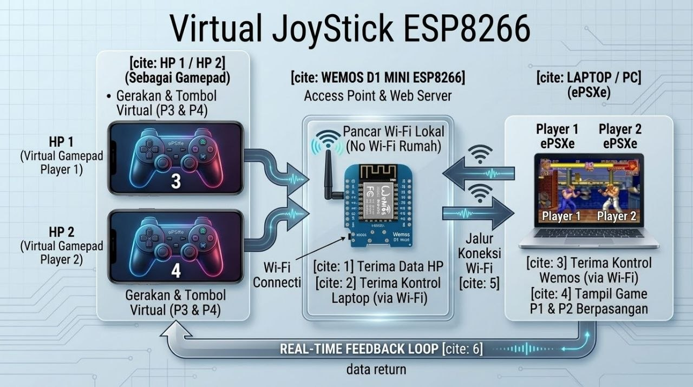

# Virtual JoyStick
Layout gamepad by COS (CusMe OS) dikembangkan kembali agar dapat dijalankan di mode offline dengan bantuan JoyStickServer.exe dan wemos sebagai pembagi sinyal/klien.

## Diagram


## Cara Install Firmware
Unduh [JoyStick.bin](https://github.com/spanelweb/virtual-joystick/releases/download/v1.0/JoyStick.bin) install pakai [FlashToolsESP8266.exe](https://github.com/spanelweb/flash-tools-esp8266/).

## Cara Bermain
- Buka laptop anda pastikan wemos terhubung di laptop anda terlebih dahulu dan buka url 192.168.4.1 sebagai admin/setelan AP.
- Unduh/Jalankan [JoyStickServer.exe](https://github.com/spanelweb/virtual-joystick/releases/download/v1.0/JoyStickServer.exe).
- Koneksikan wemos ke perangkat hp/smartphone lalu buka url 192.168.4.1 sebagai virtual gamepad. 
- Buka Emulator ePSXe untuk setting stick/gamepad virtual.
- Play and enjoy.

## Manual konfigurasi Virtual Gamepad
``` txt
Player 1 :
    'up': Key.up, 'down': Key.down, 'left': Key.left, 'right': Key.right,
    'x': 'q', 'circle': 'w', 'square': 'e', 'triangle': 'r',
    'start': 'c', 'select': 'v',
    'l1': 't', 'l2': 'y', 'r1': 'u', 'r2': 'i'

Player 2 :
    'up': 'o', 'down': 'p', 'left': 'a', 'right': 's',
    'x': 'd', 'circle': 'f', 'square': 'g', 'triangle': 'h',
    'start': 'c', 'select': 'v',
    'l1': 'j', 'l2': 'k', 'r1': 'l', 'r2': 'z'
```

<b>Terimakasih</b>

Salam, ~ <b>Suryo Dwijayanto</b>
